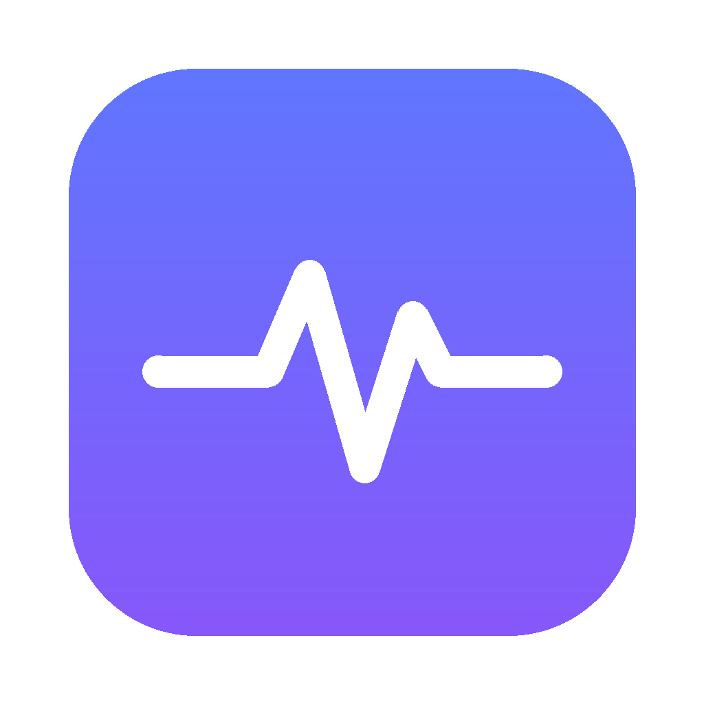

<p align="center">
  
</p>

<h1 align="center">Pulse</h1>

<p align="center">
  A tiny, native macOS menu bar monitor. See what is eating your CPU, RAM and battery, check your temperatures, and kill the culprit in one click.
</p>

<p align="center">
  <a href="../../releases/latest"><b>Download the latest release</b></a>
</p>

<!-- Add a screenshot: save it as docs/screenshot.png and uncomment the line below -->
<!-- <p align="center"></p> -->

## Features

* **Live overview.** CPU with a history sparkline, memory used and pressure, CPU temperature, battery charge and real power draw in watts.
* **Apps, grouped properly.** Helper processes roll up into their app, so every Chrome renderer counts toward Chrome. Click a row to see the individual processes.
* **Background processes.** Daemons, agents and menu bar utilities that don't belong to an open app get their own tab.
* **Sort by CPU, memory or energy**, and search by name or PID.
* **Kill from the panel.** Quit politely, force quit, or force quit as administrator for root owned processes. Critical system processes are locked so you can't log yourself out by accident.
* **Sensors.** CPU, GPU, SSD and battery temperatures on Apple Silicon (hover the tile). Battery health and cycle count.
* **Light on resources.** Samples every 8 seconds while closed and only speeds up while the panel is open. No Electron, no dependencies, no network access, no telemetry.

## Install

1. Download `Pulse-x.y.z.dmg` from [Releases](../../releases/latest).
2. Open it and drag Pulse into Applications.
3. Launch Pulse. It lives in the menu bar; there is no Dock icon or window.

If macOS says it can't verify Pulse, open **System Settings → Privacy & Security**, scroll down and click **Open Anyway**. Or run this once:

```sh
xattr -dr com.apple.quarantine /Applications/Pulse.app
```

Requires macOS 13 Ventura or later. Works on Apple Silicon and Intel (Intel Macs show thermal state instead of exact temperatures).

> On a MacBook with a notch, macOS hides menu bar items that don't fit. If you can't see Pulse, quit a few other menu bar apps or pick "Icon only" in Pulse's settings.

## Build from source

You need the Xcode command line tools (`xcode-select --install`). Full Xcode is not required.

```sh
git clone https://github.com/needahmed/pulse.git
cd pulse
./build.sh --install
```

| Command | What it does |
| --- | --- |
| `./build.sh` | Builds `Pulse.app` for your Mac |
| `./build.sh --universal` | Builds for Apple Silicon and Intel in one app |
| `./build.sh --install` | Builds, copies to /Applications and launches |
| `scripts/make-dmg.sh 1.0.0` | Packages the built app into `dist/Pulse-1.0.0.dmg` |

## How it works

| Data | Source |
| --- | --- |
| Per process CPU, memory, wakeups | `libproc` (`proc_pid_rusage`), plus one `ps` call per refresh for root owned processes |
| App grouping | `NSWorkspace` running apps and the responsible PID, same approach as Activity Monitor |
| System CPU and memory | Mach `host_statistics`, memory pressure from `kern.memorystatus_level` |
| Temperatures | IOKit HID temperature sensors (Apple Silicon) |
| Battery | IOKit power sources and `AppleSmartBattery` |

The energy column is an estimate built from CPU time and CPU wakeups. It ranks apps by drain reliably, but it is not Apple's exact Energy Impact formula.

## Releasing

Releases are built by GitHub Actions. Push a version tag and a DMG appears on the Releases page a few minutes later:

```sh
git tag v1.0.0
git push origin v1.0.0
```

To ship a signed and notarized build (no Gatekeeper warning), add these repository secrets: `MACOS_CERT_P12`, `MACOS_CERT_PASSWORD`, `APPLE_ID`, `APPLE_TEAM_ID`, `APPLE_APP_PASSWORD`. Details are at the top of `.github/workflows/release.yml`.

## Contributing

Issues and pull requests are welcome. The whole app is five Swift files in `Sources/`:

* `Sampling.swift` process and system sampling
* `Sensors.swift` temperatures and battery
* `Monitor.swift` grouping, refresh loop, kill actions
* `Views.swift` the panel UI
* `PulseApp.swift` menu bar entry point

## License

[MIT](LICENSE) © Ahmed Pervez
